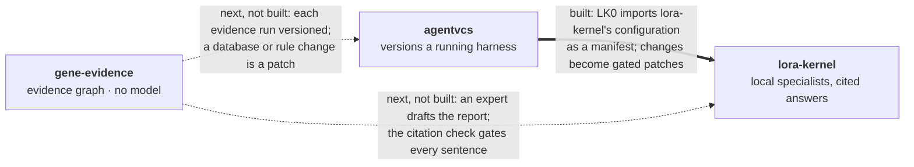

  <strong><code>EVOLVING AGENTS LABS</code></strong> 
  Open-source tools for AI systems whose results can be traced to what produced them.

---

**By [Matias Molinas](https://github.com/matiasmolinas) and [Ismael Faro](https://github.com/ismaelfaro)** — the ideas, the architecture and the code, out of an ongoing conversation between the two. The repositories are where those conversations get tested.

Three projects are active. Each asks one question, says what is built and what is not, and marks every claim **[ran]** (observed by running it) or **[read]** (from a source). Negative results are published next to the positive ones. The website lays out all three, with every number it quotes checked nightly against the file that produced it: **[evolvingagentslabs.github.io](https://evolvingagentslabs.github.io)**.

## The three active projects

### [lora-kernel](https://github.com/EvolvingAgentsLabs/lora-kernel) — active · the flagship

*Can one small local model, with a trained specialist per job and a library of notes it has learned to navigate, do an organisation's routine work, and hand the rest to a frontier model?*

An operating layer for specialized local AI agents. One small model stays resident and gets a LoRA per job, trained on *how to walk* a library of markdown notes rather than on the facts inside them. The facts stay in notes a person can read and correct, and a small router sends whatever falls outside every specialist's ground to a frontier model.

- **Built [ran]:** specialists that beat the bare base on their job; several adapters on one GPU; a router that abstains; an edited note answered without retraining; live runs through an agent runtime on a laptop.
- **Not yet:** no installable package or container, no real user traffic. Multi-hop citation on real documents stopped improving. All of it is listed in [`docs/RECORD.md`](https://github.com/EvolvingAgentsLabs/lora-kernel/blob/main/docs/RECORD.md).

### [agentvcs](https://github.com/EvolvingAgentsLabs/agentvcs) — active · Rust core v0.1

*When an agent's harness changes while it runs, can every result still be traced to the change that caused it? And can two diverging harnesses be merged on the evidence?*

Version control for agent harnesses. Every step of a run is stamped with the harness version that produced it: prompts, models, sampling, tools, adapters, router. A patch is gated before it applies, and `blame` attributes a change in a metric to the patch that brought it. Two harnesses that diverged are merged one dimension at a time. Each real conflict goes to **Claude Code, agentvcs's only LLM**, together with the evidence behind both sides, and agentvcs checks the resolution before it records it.

- **Built [ran]:** a Rust core, CLI, MCP server and Python SDK, plus a protocol with a conformance suite. On a real local model, `blame` attributed the gain to exactly the one patch applied mid-run.
- **Not yet:** no PyPI package. No real Claude Code merge session is recorded in the repository. `bisect --exec` and remotes are not built.

### [gene-evidence](https://github.com/EvolvingAgentsLabs/gene-evidence) — prototype · stage 1

*Can every sentence of a report on a predicted gene be traced to the tool output it rests on?*

Auditable evidence reports for gene predictions that the reference annotation does not have. It collects locus context, a retrocopy signature, homology, protein domains, ORF sanity and optional RNA into an evidence graph, one node per tool output with its version and database hash. It then writes a report that cites graph nodes in every sentence, and a checker fails any sentence that does not. Two runs give byte-identical output.

- **Built [ran]:** stage 1 with no language model, and a development run on rat.
- **Not yet:** a model that drafts or critiques the report.
- **Known limitation:** use a report to *explain* a candidate, not to choose which to validate first. Its fixed tiers ranked candidates worse than the gene predictor's own confidence.

## How they connect

| connection | status | what it is |
|---|---|---|
| agentvcs ↔ lora-kernel | **built** | agentvcs's [lora-kernel example](https://github.com/EvolvingAgentsLabs/agentvcs/tree/main/examples/lora-kernel) reads a lora-kernel checkout (read only) into a harness manifest. It turns measured configuration changes into gated patches and hands a conflict between two branches to Claude Code. **Imported, not live:** nothing is re-run, and the branches are built for the demo. |
| gene-evidence → lora-kernel | next, not built | a lora-kernel specialist reads the evidence graph and drafts or critiques the report, and gene-evidence's citation checker gates every sentence it writes. Today gene-evidence runs no model. |
| gene-evidence → agentvcs | next, not built | each evidence run versioned as an agentvcs run, so `blame` can trace a change in a report to the database release or rule change that caused it. Today gene-evidence records its versions in its own files. |

## Paused and archived

- [evolving-agents](https://github.com/EvolvingAgentsLabs/evolving-agents) — **paused.** The 2025 toolkit and the lab's monorepo, kept readable. Not where current work happens.
- [physics-verifiers](https://github.com/EvolvingAgentsLabs/physics-verifiers) — **paused.** A generator of physics tasks with exact truth.
- [nightshift](https://github.com/EvolvingAgentsLabs/nightshift) — **paused.** A proof-of-concept memory engine for Claude Code. Nobody has measured that it helps.
- **25 more repositories are archived** and read-only. Each is listed, with where it moved, in [the archive](https://evolvingagentslabs.github.io/archive/#all-archived).

---

Apache 2.0 · permanently alpha · <a href="https://evolvingagentslabs.github.io">evolvingagentslabs.github.io</a>
